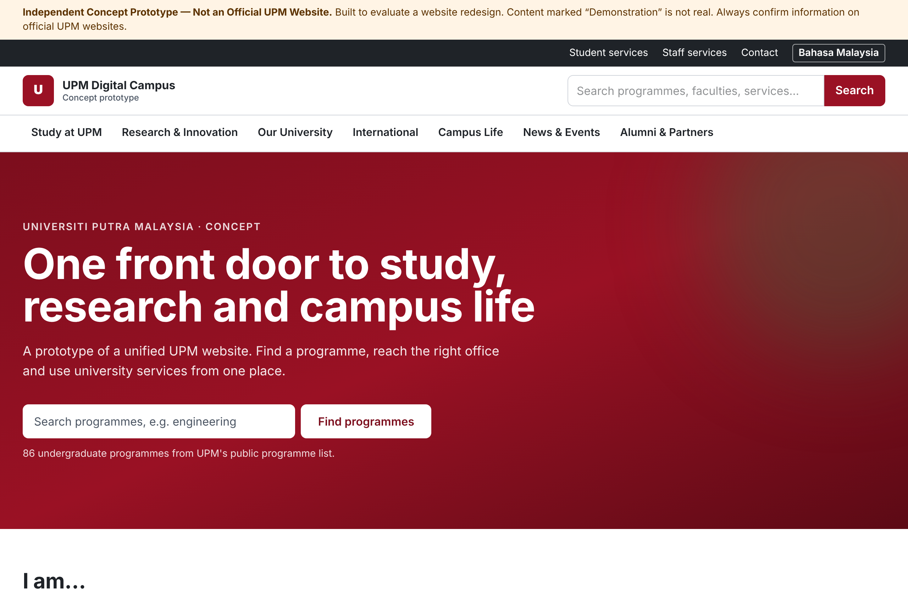

# UPM Digital Campus — Independent Concept Prototype

> **Independent Concept Prototype — Not an Official UPM Website.**
> This repository is an unofficial proposal for modernising the public website of Universiti Putra Malaysia (UPM). It is not affiliated with, endorsed by, or operated by UPM. Content marked "Demonstration" is fictional. Always confirm information on official UPM websites.



## What is here

| Area | Where |
|---|---|
| Public website audit (Milestone 0) | `docs/audit/`, `URL_INVENTORY.csv`, `SOURCE_REGISTER.md` |
| Blueprint: IA, stack, homepage, backlog, plan, estimate, risks | `docs/BLUEPRINT.md` |
| User journeys, content model, design system | `USER_JOURNEYS.md`, `CONTENT_MODEL.md`, `DESIGN_SYSTEM.md` |
| Working prototype (Milestone 3) | `src/` |
| Tests | `tests/unit` (Vitest), `tests/e2e` (Playwright + axe) |
| Test evidence | `TEST_REPORT.md` |

## Pages

Home · About UPM · Study at UPM · Programme search · Programme detail · Faculty directory · Faculty page · Research and innovation · Researcher/project discovery · International hub · Campus life · Campus map · Student services · Staff services · News and events (+ detail) · Contact and enquiry · Search · Alumni and partners. Each exists at `/en/...` and `/ms/...`.

## Run it

Requires Node.js 20.9 or later (tested on Node 22).

```bash
npm ci
npm run dev          # http://localhost:3000 (redirects to /en)
npm run check        # lint + type check + unit tests
npm run build
npx playwright install chromium   # first time only, if you have no Chromium
npm run test:e2e     # builds must exist; starts the server on port 3100
```

## Data honesty rules

- Every record in `src/data/` carries `provenance`: `verified` (with source IDs from `SOURCE_REGISTER.md` and a check date) or `demo`.
- No fees, entry requirements, visa rules, staff names or research records are invented. Where verified content is missing, the page says so.
- The UPM logo is not used. The brand red is provisional until UPM's corporate identity manual is supplied.
- The enquiry form validates but never sends data. There are no login pages.

## Conventions

TypeScript strict mode, ESLint (Next.js core-web-vitals + TypeScript), one commit per meaningful change, documentation updated with code. Distinguish **verified existing**, **proposed** and **implemented** functionality in all docs.
